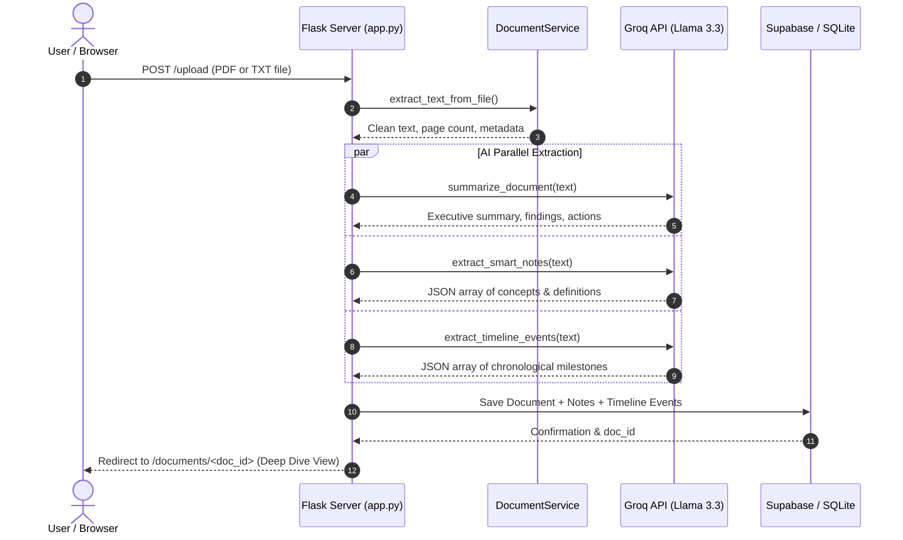

# Chronicle AI — Intelligent Document & Knowledge Management System

Chronicle AI is an intelligent document management and knowledge platform powered by **Flask**, **Groq Llama 3.3 70B**, and **Supabase** (with seamless local SQLite resilience). It ingests PDF, TXT, and Markdown files to automatically produce multi-level summaries, grounded natural language document chat, smart conceptual notes, and chronological milestone timelines.

---

## 🏛️ System Architecture Overview

```
                                  +------------------------------------+
                                  |         Chronicle AI Web UI        |
                                  |  (HTML5, Vanilla CSS, JS, Bootstrap)|
                                  +-----------------+------------------+
                                                    |
                                         HTTP / REST APIs
                                                    |
                                                    v
                                  +------------------------------------+
                                  |          Flask Application         |
                                  |              (app.py)              |
                                  +--------+--------+--------+---------+
                                           |        |        |
                   +-----------------------+        |        +-----------------------+
                   |                                |                                |
                   v                                v                                v
+------------------------------------+  +-----------------------+  +------------------------------------+
|          DocumentService           |  |      GroqService      |  |          SupabaseService           |
|  - Native PDF Parsing (PyMuPDF)    |  |  - Groq LPU Engine    |  |  - Supabase Cloud Database / Auth  |
|  - Text Extraction (pypdf/txt)     |  |  - Llama 3.3 70B      |  |  - Automatic SQLite Local Engine   |
|  - Context Overlap Chunking        |  |  - Summary & Findings |  |  - Document & Chat Persistence     |
|  - Lexical RAG Retrieval           |  |  - Concept Extraction |  |  - Notes & Timeline Events Store   |
+------------------------------------+  |  - Timeline Detector  |  +------------------------------------+
                                        +-----------------------+
```

---

## 📁 Repository Directory Structure

```
chronicle-ai/
├── app.py                      # Main Flask application and REST routes
├── requirements.txt            # Python package dependencies
├── .env.example                # Sample environment configuration template
├── .env                        # Active environment variables (API keys, ports)
├── .gitignore                  # Git tracking rules
├── schema.sql                  # Dual-compatible DB schema (PostgreSQL & SQLite)
├── README.md                   # System documentation & architectural reference
│
├── services/                   # Modular service layer
│   ├── __init__.py             # Package exports
│   ├── document_service.py     # PDF & TXT parser, chunking, and lexical RAG search
│   ├── groq_service.py         # Groq Llama 3.3 integration (summaries, chat, notes, timeline)
│   └── supabase_service.py     # Supabase PostgREST client with automatic SQLite fallback
│
├── templates/                  # Jinja2 HTML templates
│   ├── base.html               # Master layout with responsive nav & glass notifications
│   ├── index.html              # Modern dark-mode landing page with feature showcase
│   ├── login.html              # Authentication sign-in form
│   ├── register.html           # User registration form
│   ├── dashboard.html          # Personal Knowledge Dashboard & document vault
│   ├── upload.html             # Drag-and-drop document upload interface
│   ├── document_detail.html    # In-depth tabs: Summary, Notes, Timeline, Raw Text
│   ├── chat.html               # Intelligent Document Chat with multi-turn history
│   ├── notes.html              # Smart Notes vault with category filters & creation modal
│   └── timeline.html           # Chronological timeline visualization
│
├── static/                     # Static assets
│   ├── css/
│   │   └── style.css           # Glassmorphism dark theme, custom glows, and animations
│   └── js/
│       └── script.js           # AJAX chat streaming, dropzone handler, dynamic filters
│
└── uploads/                    # Local storage directory for uploaded documents
```

---

## ⚡ 5 Core Functional Pillars

| # | Feature | Architecture Component | Description |
|---|---------|------------------------|-------------|
| **1** | **AI Document Summarizer** | `groq_service.py` -> `summarize_document()` | Generates multi-tier outputs: Executive Overview, Key Findings list, and Action Items. |
| **2** | **Intelligent Document Chat** | `document_service.py` (RAG) + `groq_service.py` | Answers queries grounded in document excerpts with citations. Supports single-doc & library-wide scopes. |
| **3** | **Smart Notes Extraction** | `groq_service.py` -> `extract_smart_notes()` | Extracts definitions, formulas, key concepts, and decisions with tags into persistent note cards. |
| **4** | **AI Chronological Timeline** | `groq_service.py` -> `extract_timeline_events()` | Detects all dates, milestones, deadlines, and launches into an interactive vertical visual timeline. |
| **5** | **Personal Knowledge Dashboard** | `app.py` -> `/dashboard` & `supabase_service.py` | Overview of documents, reading extent, quick search, recent activity, and unified statistics. |

---

## 🔄 End-to-End Data Pipeline



---

## 🗄️ Database Architecture (`schema.sql`)

1. **`users`**: User identity, hashed passwords (bcrypt/werkzeug), and timestamps.
2. **`documents`**: Ingested files, paths, character/page counts, executive summaries, key findings JSON, and action items JSON.
3. **`notes`**: Concepts, definitions, categories (`Key Concept`, `Definition`, `Action Item`), tags, and document links.
4. **`timeline_events`**: Identified dates (`date_str`), parsed ISO dates, titles, descriptions, and event classifications (`milestone`, `deadline`, `meeting`, `launch`).
5. **`chat_messages`**: Conversational history with role (`user` vs `assistant`), grounded source snippets, and session tokens.

---

## 🚀 Getting Started

### 1. Environment Setup
Configure your [.env](file:///d:/Projects/choronic.ai/.env) file:
```env
FLASK_SECRET_KEY=your_secret_key_here
PORT=5000

# Free API key from https://console.groq.com/keys
GROQ_API_KEY=gsk_your_groq_api_key_here
GROQ_MODEL=llama-3.3-70b-versatile

# Supabase (Optional: if left empty, local SQLite storage is automatically used)
SUPABASE_URL=
SUPABASE_KEY=
```

### 2. Create Virtual Environment (first time only)
```powershell
python -m venv venv
```

### 3. Install Dependencies
> **⚠️ Always use the venv pip — NOT the system `pip` command!**

```powershell
# Windows (PowerShell)
.\venv\Scripts\pip.exe install -r requirements.txt
```

> **If pip can't reach PyPI (DNS/network issues)**, use the Tsinghua mirror:
> ```powershell
> .\venv\Scripts\pip.exe install -r requirements.txt -i https://pypi.tuna.tsinghua.edu.cn/simple/ --default-timeout=120
> ```

### 4. Run Application
```powershell
# Windows
.\venv\Scripts\python.exe app.py
```
Open **`http://localhost:5000`** in your browser.
